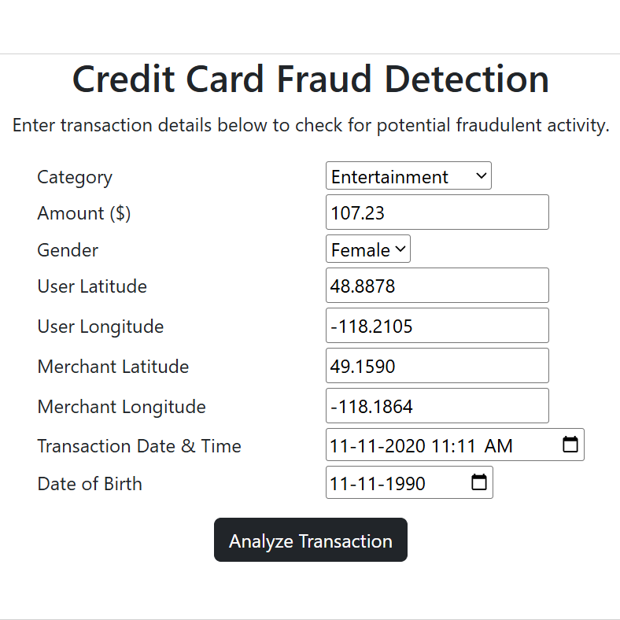

# Credit Card Fraud Detection

Problem Statement: To identify credit card fraudulent.

Solution: An end-to-end Machine Learning pipeline designed to identify fraudulent credit card transactions in heavily imbalanced datasets, achieving 0.8523 PR-AUC, 0.95 Fraud Class Recall (Captures ~95% of actual frauds) and 0.99 Overall Accuracy.



## Tech Stack
- Data Science: NumPy, Pandas, Matplotlib, Seaborn, Scikit-Learn
- Machine Learning: eXtreme Gradient Boosting.
- Deployment: HTML5, CSS3, Bootstrap, Git, GitHub and Render Platform.

## Setup Installation
```
pip install pandas numpy matplotlib seaborn scikit-learn joblib
git clone https://github.com/ujjwalkumar14b/Credit_Card_Fraud_Detection.git
cd Credit_Card_Fraud_Detection
```

## Author
Ujjwal Kumar
GitHub: [https://github.com/ujjwalkumar14b](https://github.com/ujjwalkumar14b)
